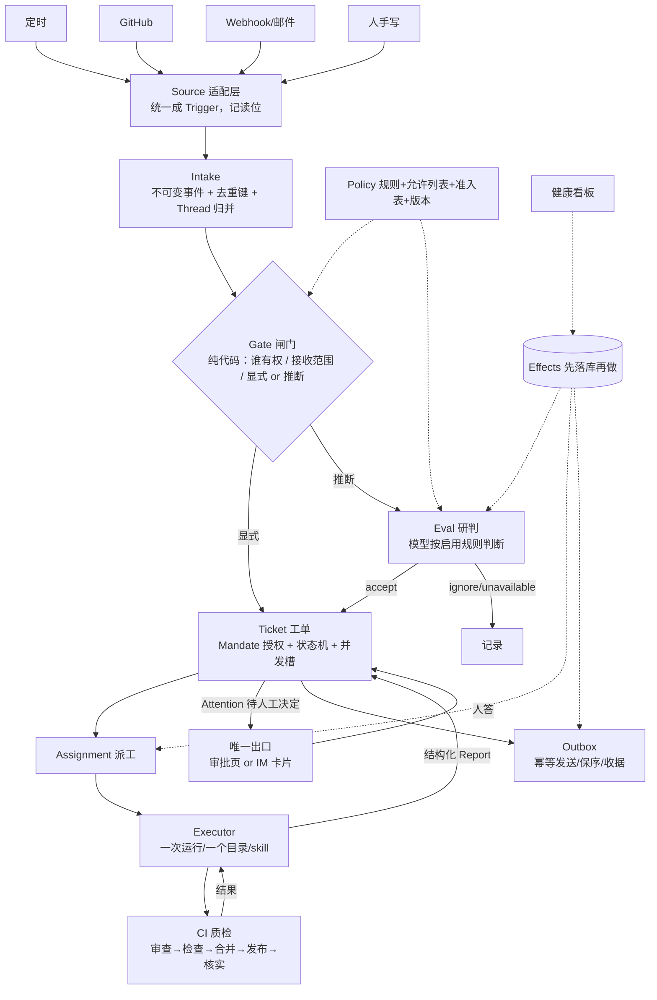

# 03 · 结合《Super-agent 设计探索》的系统设计

> 输入：
> - A：数字生命卡兹克《折腾了整整1年……》（2026-11-02，本机归档 `wechat_article/`）
> - B：DeepSeek Harness《Super-agent 设计探索：迈向更自主的 Agent 系统》（2026-10-31）
>   - 原文微信链接被验证码拦截；实际通读的是官方开源原型 [dsh-superagent-prototype](https://github.com/deepseek-ai/dsh-superagent-prototype) 的 9 份设计文档（域模型 / 授权 / 执行 / 提示词 / 面板 / 部署 / 架构 / 扩展手册 / 哲学），它就是这个架构的工程版本
>   - 辅以 [36氪解读](https://eu.36kr.com/en/p/4050650194630536)、[腾讯云架构解析](https://cloud.tencent.cn/developer/article/2774771)、[环球网报道](https://finance.sina.com.cn/roll/2026-11-01/doc-inixeyiz3146996.shtml)
> 本文目的：两篇对照，重新定我们这个系统该怎么设计。

---

## 0. 三句话结论

1. **两篇文章在讲同一个洞察，但站在产业链的两端**：A 是「一个人一年摸索出来的运行中的系统」，B 是「一个团队把这件事抽象成架构」。A 提供痛点和取舍，B 提供严谨的模型。
2. **B 比 A 多出来的东西，恰好是 A 将来一定会崩的地方**：没有授权模型、没有「工单」生命周期、没有结构化上报、没有可靠投递。A 的 `rules.json + 去重 + 重派 3 次` 是这些问题的临时解。
3. **我们该做的不是抄 A 或抄 B，而是「A 的骨架 + B 的三件内核」**：事件中台和 CI 中台的骨架照 A；准入/研判两层、授权对象（Mandate）、先落库再做（effect/outbox）照 B。规模上我们只有一个人一台机器，B 的 90% 复杂度要砍掉。

---

## 1. 同一个洞察，四种说法

| 洞察 | A（卡兹克）的说法 | B（DeepSeek）的说法 |
|---|---|---|
| **人的注意力是瓶颈** | 「一个人管不过来，所以要批奏折」；七大上报白名单 | 「每次消息、通知、提问、设置项都要付注意力成本，付不起就删掉」——注意力是**设计的第一成本项** |
| **任务起点必须离开人** | 用事件触发，而不是等命令；朱元璋不能靠一个人硬扛 | Source → Trigger：系统值守环境，不是人值守系统 |
| **系统管会话，人管任务** | 飞书卡片，一点即决策 | 「让用户手动管理 Session，很大程度上是 LLM API 时代留下的设计惯性」——**session 不是产品形态，任务才是** |
| **只在该打扰时打扰** | 唯一出口「小卡」，七类事才推 | 结构化 `Attention`（待人工决定）是一等概念；静默是默认，健康状态不占面板空间 |

> 两篇在价值观上完全一致。真正的分歧在于**系统凭什么相信一个信号值得开工**——这才是设计的分水岭。

---

## 2. 分水岭：智能放在哪一层

### A 的做法：确定性规则路由 + 判断力下沉到 skill

```
事件 → 鉴权 → 去重 → 匹配 rules.json（来源+类型）→ 排队 → 派单
                                                        └→ Agent 读 skill，在干活时做判断
```

- 优点：简单、可预测、便宜。加一种事件 = 加一条规则。
- 局限：**只能匹配结构化信息**（来源、类型）。规则匹配不上「群里有人说这个按钮有点怪」这种非结构化信号。A 自己也是这么用的——他的事件源都是「同事提了一条意见 #12」这种已经被结构化过的对象。

### B 的做法：确定性闸门 + 模型研判，两层

```
Trigger → Gate（纯代码：谁有权发起 / 接收范围 / 显式还是推断）→ 仅对"推断"候选 → Assessment（模型按规则研判）
                                                                                       └→ Decision: accept / stop / ignore / unavailable
```

- Gate 保证「权限」永远不由模型决定（**消息、评论、引用文档都是数据，不能改权限**）。
- Assessment 只在「没人 @ 你但可能有活」时启动，**每条启用的规则都要给出一次判断**，接受必须带上「意图证据 + 是否存在未决的设计决定」。
- 三档模式：`off` / `observe`（只记录"我本来会接"）/ `auto`（真接）。

### 对我们的结论

> **结构化来源（定时、GitHub Issue/PR、告警）用 A 的规则路由就够；非结构化来源（群聊、评论、邮件）必须上 B 的两层。**
> 这不是"B 更聪明"，而是：**写不成规则的那部分，只能交给模型**——但要在模型前面先放一道确定性闸门，把"谁有权让 Agent 干活"从模型手里拿走。

---

## 3. B 比 A 多出的 5 件东西（我们必须补的）

### 3.1 授权是一个对象：Mandate

A 的规则里有 `to`（交给谁）、`tell`（要不要告诉我），但没有「**凭什么这件事可以被做、能做多大、依据哪版规则**」。

B 把它抽成 `Mandate`（授权）：

| 字段 | 含义 | 我们为什么需要 |
|---|---|---|
| strength | `explicit`（人明确要求）/ `inferred`（推断出来的候选） | 推断出来的活只能做小改动，明确要求的活可以更大 |
| scope | 这次能干多大的活 | 防止"修个错别字"变成"重构整个模块" |
| policy version | 接受时依据的规则版本 | 规则改了，在途的活要不要停/通知，有据可依 |
| basis | 怎么被允许的：被 @、被允许列表、准入表、机器人 | 事后审计：这活是谁让干的 |

关键规则（都要抄）：
- **Mandate 不可变**；范围变大 = 新开工单。
- **工单结束 ≠ 授权撤销**；后续有人在同一条线索里说话，可以按原授权恢复。
- **只有人能撤销**（person's stop）；规则不再成立时**复核**撤销，不直接取消在跑的活。
- **恢复前必须复核**：来源还在监听、发起人还在允许列表、规则还启用——不通过就不恢复。

### 3.2 Thread / Subscription：让后续讨论直达干活的人

A 的模式是「Agent 干完 → 结论回写中台」。问题是：**活干到一半，有人在原帖下面说「换个改法」，这句话又回到中台，中台再重新匹配规则、重新派单。**

B 的办法：
- `Thread`（线索）= 一条时间有序的 Trigger 流；同一 Thread 同时只有一个研判在跑。
- `Ticket` **订阅**它相关的 Thread；订阅来的消息直接喂给执行者当上下文，**不给新权限、不重新研判**。
- 只有"人"的消息能恢复已结束的工单做后续；机器人/CI 的消息只做上下文。
- 上下文订阅（`context-only`）只加信息、不给权限、也不唤醒。

> 大白话：**维修工接了单，后续问题直接找维修工，不用再打客服电话转一遍。** 这是 B 对 A 最重要的流程修正。

### 3.3 结构化的 Report 和 Attention

A 的结论是「Agent 写一段话回中台」，靠人去读。B 强制结构：

- `Report`：`progress`（进展，只在工单内可见）/ `waiting`（等新信号）/ `ready`（可验收）/ `blocked`（卡住，需要人）/ `failed` / `dropped`（没活可干，安静关单）。
- `Attention`（待人工决定）：**一个具体问题 + 选项 + 证据**，不是一段自由文本。问题会自动跟到「提出这个请求的那条消息」下面，而不是丢在一个没人看的会话里。
- 一次只问一个问题；已经授权的活可以继续干，不阻塞。

> 这条直接决定「批奏折」的质量：A 的卡片之所以好批，是因为背后的结论已经被结构化了。我们要把这个结构写进协议，而不是靠 Agent 自觉。

### 3.4 先落库再做（durable effects + outbox + 健康看板）

A 的可靠性是散落的：去重、长轮询、重派 3 次、掉线上报。B 把它做成一套通用机制：

| 机制 | 作用 | 我们的简化版 |
|---|---|---|
| **Effect 队列** | 每条"决定之后要做的事"（研判、启动、投递、转发、通知、发送）先入库，提交后再执行；按 kind 重试/退避/合并；`Later` 表示"暂时做不了"不算失败 | SQLite 一张 `effects` 表 + 单进程轮询，够用 |
| **Outbox + 幂等发送** | 消息先记收据再发；同一工单同一会话的消息严格保序；只有"永久发不出去"才标 dropped | `receipts` 表 + 消息 id 当幂等键 |
| **健康看板** | 每个部件（runtime/evals/models/每个 effect kind/每个 Source）有一个健康条目，**只有它的唯一写者能写**；连续 3 次失败才报错 | 一张 `health` 表 + 状态命令 |
| **重启恢复** | 在跑的 Assignment 记录"host restarted"，新 Assignment 带恢复说明（先看目录/git/GitHub 再重复动作）；未读消息重新投递 | 启动时比对 `runs` 表状态 |
| **暂停处理** | 暂停只停派发，不停记录；恢复后 eval 超时顺延，不误判 | 一个 `paused` 开关 |

> 我们的量级不需要分布式的这套东西，但**「先落库，再执行」这个顺序**必须一开始就有——否则"消息发出去了但库里没记"这类事会让你永远对不上账。

### 3.5 渐进授权与"被拒绝的概念"

- `off → observe → auto`：先只记录"我本来会接这个活"，人看几天觉得对，再放开。
- **"被拒绝的概念"表**（B 的 001 文档里有一整张）：把"我们明确不要的东西"写下来，并写清为什么。这是防止设计膨胀的最好办法，我们会照抄这一节（见第 8 节）。

---

## 4. A 比 B 多的 3 件东西（别丢）

| A 有、B 原型没有 | 为什么重要 |
|---|---|
| **CI 中台五步**（审查→检查→合并→发布→核实），审查只读无网无密钥、最多 3 轮、只报真错、一次性环境、分支保护 | B 的原型把合并交给提示词（"改动小于 200 行且审批覆盖 head 才允许自动合并"），**没有独立的质检层**。Agent 写的代码不能自己上线，这条 A 是对的 |
| **决策记忆库**（`定了的事.md` / `定了不做的事.md`，带原话和日期） | B 用"Policy / 规则"表达同一件事，但只覆盖"什么算活"，不覆盖"人做过哪些决定"。A 这个土办法能直接消灭重复提问，是长期不被打扰的根本 |
| **跨机执行 + 唯一出口**（长轮询拉模式、所有 Agent 只走一个 IM 出口） | B 的原型默认执行器和中台在同一个 DSH 进程里。我们如果要调用本机 codex/Claude，或者以后要换机器，A 的拉模式仍然是最省事的解法 |

---

## 5. 合并后的设计

### 5.1 分层



### 5.2 合并后的 7 条设计原则

1. **注意力预算**：每条消息/通知/提问/设置都标价，付不起就砍掉；健康状态不占地方；默认闭嘴。
2. **权限只由代码决定**：消息、评论、引用文档都是数据，永远改不了权限；模型只做"这算不算活"的研判。
3. **两道闸门**：结构化信号走规则路由；非结构化信号走「确定性 Gate + 模型研判」，且先 observe 再 auto。
4. **授权是对象**：每个工单都记「为什么能做、能做多大、依据哪版规则、谁让做的」；只有人能撤销；恢复要复核。
5. **一个工单 = 一个执行者 + 一个目录 + 一条订阅线**；后续讨论直达执行者，不再回路由。
6. **先落库再做**：所有"决定之后要做的事"进 effect 表，提交后执行；消息先记收据再发；连续失败才报错。
7. **结构化的上报**：Report 六态 + Attention 一个问题 + 选项 + 证据；没有结构的结论等于没结论。

### 5.3 领域模型（B 的简化版，落到一个人一台机器）

| 概念 | 我们的定义 | 关键规则 |
|---|---|---|
| Source | 一个事件来源实例（定时器 / GitHub 仓库 / Webhook） | 记录读位；丢掉自己发的消息；在过期前可重放 |
| Trigger | 一条不可变事件（`id`/来源/线程/发起人/是否 @ 我/摘要/回链） | 同一个 `id` 只处理一次；**审计和幂等的单位** |
| Thread | 一条时间有序的线索（如一个 Issue、一个话题） | 同一线程同时只跑一个研判 |
| Policy | 规则集合 + 允许列表 + 准入表 + 版本号 | 版本变了，在途研判作废重跑；在途工单只"通知"不"取消" |
| Eval | 对一批 Trigger 的研判，两层：Gate + Assessment | 只对"推断"候选启动；输出 accept/stop/ignore/unavailable |
| Mandate | 授权：强度、范围、规则版本、依据 | 不可变；范围变大=新工单；只有人 stop 能撤 |
| Ticket | 一个工单，授权的工作单位 | `queued → working → attention/ready/blocked/failed → ended`；结束不撤销授权 |
| Assignment | 工单绑一次执行 | pending→running→ended；重试=同一个目录/分支上换一次运行 |
| Report | 执行者结构化结果 | 六态 + 一个问题（如有） |
| Attention | 待人工决定 | 一个问题 + 选项 + 证据 + 建议；跟到原消息下 |
| Effect / Receipt | 先落库的副作用 / 消息收据 | 按 kind 重试退避；消息保序；永久失败标 dropped |

工单状态机（我们的版本）：

```
                     ┌──────────── 人停止（撤销授权）
                     ▼
新建 ──▶ queued ──▶ working ──┬──▶ attention（等我答）
                                ├──▶ ready（可验收 / 待合并）
                                ├──▶ blocked / failed（我动手才继续）
                                └──▶ dropped（没活，安静关单）
                                     │
已结束 ◀───────────────────────────┘
    └── 有人在线索里说话 ──▶ 复核授权 ──▶ 恢复 working
```

### 5.4 三档模式与第一批规则

| 模式 | 行为 | 什么时候用 |
|---|---|---|
| `off` | 只有显式请求才开工 | 第一天默认 |
| `observe` | 推断候选照常研判，只记"本来会接"，不真开工 | 接非结构化来源后的前 1~2 周 |
| `auto` | 研判通过就开工 | 看过一段时间 observe 记录，确认判断可信之后 |

第一批规则（每条都是一句话，B 的做法：规则文本可以被人直接改）：

- 「群里有人说某功能坏了/按钮不对，且能定位到我们仓库的具体位置」→ 允许小范围修复
- 「有人明确要求加一个功能」→ **不**自动接（属于改产品方向 → 推给我）
- 「CI 挂了且是仓库默认分支」→ 自动查、能修就修

### 5.5 面板 / Inbox 只回答三个问题

1. 现在有什么需要我？（只有 `person` 阶段的东西）
2. 系统健康吗？在干该干的事吗？（异常才显示）
3. 某件事从头到尾发生了什么？（Trigger → 研判 → 工单 → 执行）

> 面板不是仪表盘。**一个健康的状态不应该占屏幕。** 这条我们之前的 02 清单里没有，要补。

---

## 6. 九个关键设计取舍

| # | 取舍 | 选项 A | 选项 B | 建议 | 理由 |
|---|---|---|---|---|---|
| 1 | 实现形态 | 独立服务（FastAPI+SQLite+worker） | DSH 插件（像 B 那样） | **独立服务，执行器可插拔** | 不被单一产品绑死；我们还要跑本机 codex；DSH 插件学习成本高 |
| 2 | 首个触发方式 | 定时（只读巡检） | GitHub 评论（能验准入） | **定时起步，P1 接 GitHub** | 先跑通链路，再验权限模型 |
| 3 | 路由智能 | 只用规则 | 闸门+研判 | **闸门先上，研判 P1** | 结构化来源用不到研判，别提前付成本 |
| 4 | 执行落点 | 本机 codex CLI 拉模式 | DSH 进程内 Session | **codex 拉模式，留 DSH adapter** | 跨机、可换、不绑死 |
| 5 | 授权模型 | 不做（A 现状） | 完整 Mandate | **简化 Mandate（4 字段）** | 一旦接群聊/GitHub，没有授权就是漏洞 |
| 6 | 后续讨论 | 回中台 | 订阅直达 | **订阅直达（P1）** | A 的"回中台"会产生语义重复工单 |
| 7 | 上报格式 | Agent 自由写 | 结构化 Report + Attention | **结构化** | 决定审批卡片质量；也决定能不能自动过滤 |
| 8 | 可靠性 | 重试 3 次 | effect/outbox/健康板 | **P0 就上 effect 表** | 后补比一开始就做痛苦得多 |
| 9 | 成本 | 单模型 | 分级 + 预算 | **研判用便宜模型，执行用强模型，每单预算** | B 自己也承认多会话更烧 token |

---

## 7. 对 MVP 清单（02 文档）的修订

### 增加（P0 就要有）

| 新增 | 为什么 |
|---|---|
| 领域表：`triggers / threads / tickets / mandates / reports / effects / receipts` | 之前是 `events / runs / decisions`，太薄，撑不住授权和订阅 |
| 确定性 Gate（允许列表 + 接收范围 + 显式/推断） | 不加的话，接任何非结构化来源都是裸奔 |
| 结构化 Report 协议（六态 + 一个问题） | 派工和上报的接口必须一开始就定死 |
| Effect 表 + 幂等键 | 「先落库再做」 |
| 健康看板（每部件一个条目）+ 暂停开关 | 不然系统坏了你不知道 |

### 调整

| 原来 | 改成 |
|---|---|
| 去重：靠 `idempotency_key` | 去重：`Trigger.id` 稳定推导 + 线程内语义去重（研判时看已有工单） |
| 结论回写：自由摘要 | 结论回写：结构化 Report，摘要由中台生成 |
| 重派：失败重试 3 次 | 重派：effect 队列按 kind 退避 + 连续 3 次进健康看板 |
| 审批页：列出待决策 | 审批页：只列 `Attention`，每条带建议答案和证据 |

### 后置（P2 之后）

- `observe → auto` 的自动切换策略
- 上下文订阅 / 工单订阅线
- Watchdog（B 的"店长巡店"：不只看进程活着，还看任务有没有在推进、方向有没有跑偏）—— 我们先做阈值告警，不做模型审计
- 云端脑 / 本地机分离

### 验收标准补充

> **每周推给我的条数 ≤ 10，且我阅读每条的平均时间 < 30 秒。**
> 超过这个数，就不许加新事件源——先改规则和上报。

---

## 8. 我们明确不做的（"被拒绝的概念"）

| 拒绝 | 理由 |
|---|---|
| 多仓库 / 多团队 / 多租户 | 一个人一台机器。需要时再加，不为想象的需求付税 |
| 跨来源身份映射（飞书账号 ↔ GitHub 账号） | B 把它降级成提示词里的文本，我们也这么做 |
| Router（主会话）拆解任务、规划子任务、做技术决策 | B 明确规定 Router 只路由（≤30 词），不做技术决策；这正好避开了"A 主 Agent 带一堆 subagent"的低效陷阱 |
| Subagent 递归派活 | 同上，只会让上下文和成本失控 |
| 云端执行脑 + 本地数据面分离 | 我们是个人规模、账号全在本机，先本地。代码分层留口即可 |
| 用模型做 Watchdog 审计任务方向 | 先做延迟/停滞/连续失败告警；模型审计等有数据再说 |
| 自由文本上报 / 群发进度 | 每条消息都要付注意力成本 |
| 可视化流水线（"自动化小镇"） | 爽感需求，等 P2 稳定再说 |

---

## 9. 还需要你拍板的三件事

1. **形态**：独立服务（推荐）还是做成 DSH 插件？
   → 前者自由、能跨机；后者白捡 Session/工具/面板，但绑死 DSH。
2. **P0 多花 2 天把「工单 + 授权 + 结构化上报」做对**，还是先做最薄的事件流水线、以后再补？
   → 我建议前者：这三件事是骨架，后补等于重写。
3. **第一个非结构化来源**（GitHub 评论 / 飞书群）什么时候接？
   → 我建议排在 P1 末尾，先在 `observe` 模式跑一周，看看"我本来会接哪些活"。

---

## 附：两篇文章的对照速查

| 维度 | A（卡兹克） | B（DeepSeek） | 我们 |
|---|---|---|---|
| 单位 | 事件 → 任务 | Source → Trigger → Thread → Ticket | Trigger → Thread → Ticket |
| 触发 | 定时 + Webhook + 人 | Source 值守 + 键鼠/邮件/GitHub | 定时 + GitHub + Webhook，后加群聊 |
| 准入 | 鉴权 + rules.json 匹配 | 确定性 Gate + 模型研判（off/observe/auto） | Gate 先行，研判 P1 |
| 授权 | 规则即授权（隐式） | Mandate（强度/范围/版本/依据） | 简化 Mandate |
| 后续讨论 | 结论回中台 | Subscription 扇出直达 | 订阅直达（P1） |
| 执行 | 接单程序 + skill（跨机） | 一个 Ticket 一个 Session 一个目录 | worker + codex CLI，一个目录 |
| 上报 | 自由文本回中台 | 结构化 Report 六态 + Attention | 结构化 |
| 质检 | CI 中台五步 | 交给提示词 + 分支保护 | 先 GitHub Actions + 分支保护，后自建 |
| 可靠性 | 去重/长轮询/重派 3 次 | effect 队列 + outbox + 健康板 + 重启恢复 | effect 表 + 收据 + 健康板 |
| 人机接口 | 飞书卡片（票拟/批红） | 面板（只在需要时出现）+ IM | 本地审批页 → 飞书卡片 |
| 记忆 | `定了的事` / `定了不做的事` | Policy + 提示词 | 两者都要 |
| 体量 | 个人系统，多机，真实在跑 | 团队架构，原型，单仓库 | 个人系统，单机，逐步长 |
